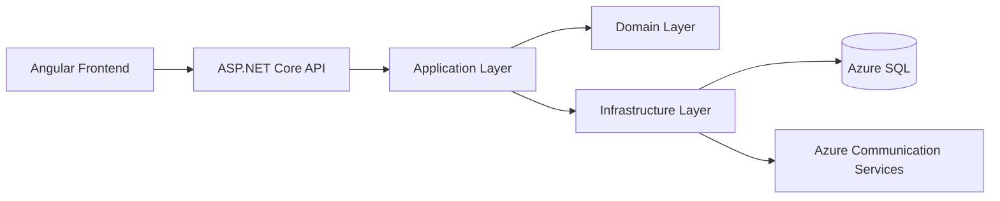
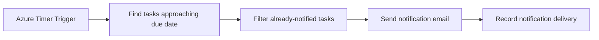

# Task Management

A full-stack task management application built with ASP.NET Core, Angular, SQL Server, JWT authentication, and email verification.

## Live Application

- Frontend: https://orange-water-0b690510f.3.azurestaticapps.net
- API: https://taskmanagement-api-carlos.proudocean-d409b2a8.brazilsouth.azurecontainerapps.io
- Swagger: https://taskmanagement-api-carlos.proudocean-d409b2a8.brazilsouth.azurecontainerapps.io/swagger/index.html

## User Story

As a registered user, I want to create, view, update, complete, and delete tasks with a title, description, due date, time, and status, so that I can organize my work and track my progress.

## Features

- User registration and login.
- Six-digit email verification.
- Controlled verification-code resend.
- JWT authentication.
- Bearer token authorization.
- Full task CRUD.
- Task statuses:
  - Pending
  - In progress
  - Completed
- Due date and time management.
- Dashboard with task statistics.
- Responsive desktop and mobile interface.
- Toast notifications.
- Confirmation dialog before deleting tasks.
- Azure deployment.
- Unit tests for backend and frontend.

## Architecture

The backend follows Clean Architecture principles:



### Backend layers

- `TaskManagement.Api`
  - Controllers.
  - Authentication configuration.
  - CORS.
  - OpenAPI and Swagger.
  - Dependency injection.
  - HTTP pipeline configuration.

- `TaskManagement.Application`
  - Application services.
  - Interfaces.
  - Contracts and DTOs.
  - Business rules.

- `TaskManagement.Domain`
  - Domain entities.
  - Core domain behavior.
  - Domain-level rules.

- `TaskManagement.Infrastructure`
  - Entity Framework Core.
  - SQL Server persistence.
  - Repositories.
  - JWT token generation.
  - Azure Communication Services email integration.

### Frontend layers

- `core`
  - Authentication.
  - HTTP interceptor.
  - Route guard.
  - Task service.
  - Notifications.
  - Shared configuration.

- `features`
  - Login.
  - Registration.
  - Email verification.
  - Dashboard.
  - Task list.
  - Task creation and editing.

- `shared`
  - Application shell.
  - Toast notifications.
  - Confirmation dialog.
  - Shared layout components.

## Project Structure

```text
task-management-app/
├── backend/
│   ├── TaskManagement.Api/
│   ├── TaskManagement.Application/
│   ├── TaskManagement.Domain/
│   ├── TaskManagement.Infrastructure/
│   ├── TaskManagement.Api.Tests/
│   ├── TaskManagement.Application.Tests/
│   └── TaskManagement.Infrastructure.Tests/
│
├── frontend/
│   ├── src/
│   │   └── app/
│   │       ├── core/
│   │       ├── features/
│   │       └── shared/
│   └── package.json
│
└── README.md
```

## Requirements

### Backend

- .NET 10 SDK.
- SQL Server or Azure SQL Database.
- Azure Communication Services Email resource for email verification.
- Valid Azure email sender address.

### Frontend

- Node.js.
- npm.
- Angular CLI 22.

## Running the Backend Locally

Navigate to the backend directory:

```powershell
cd backend
```

Restore dependencies:

```powershell
dotnet restore
```

Run the API:

```powershell
dotnet run --project .\TaskManagement.Api\TaskManagement.Api.csproj
```

The API applies pending Entity Framework migrations during startup and seeds demo data when seeding is enabled.

The local Swagger URL is displayed in the terminal when the API starts.

## Local Configuration

Sensitive configuration values must not be committed to the repository.

Initialize user secrets:

```powershell
dotnet user-secrets init `
  --project .\TaskManagement.Api\TaskManagement.Api.csproj
```

Configure the required values:

```powershell
dotnet user-secrets set `
  "ConnectionStrings:DefaultConnection" `
  "<SQL_SERVER_CONNECTION_STRING>" `
  --project .\TaskManagement.Api\TaskManagement.Api.csproj

dotnet user-secrets set `
  "Jwt:Key" `
  "<JWT_SECRET_KEY>" `
  --project .\TaskManagement.Api\TaskManagement.Api.csproj

dotnet user-secrets set `
  "Jwt:Issuer" `
  "TaskManagement.Api" `
  --project .\TaskManagement.Api\TaskManagement.Api.csproj

dotnet user-secrets set `
  "Jwt:Audience" `
  "TaskManagement.Ui" `
  --project .\TaskManagement.Api\TaskManagement.Api.csproj

dotnet user-secrets set `
  "Email:ConnectionString" `
  "<AZURE_EMAIL_CONNECTION_STRING>" `
  --project .\TaskManagement.Api\TaskManagement.Api.csproj

dotnet user-secrets set `
  "Email:From" `
  "<VERIFIED_SENDER_ADDRESS>" `
  --project .\TaskManagement.Api\TaskManagement.Api.csproj
```

The following configuration names are used by the application:

```text
ConnectionStrings:DefaultConnection
Jwt:Key
Jwt:Issuer
Jwt:Audience
Email:ConnectionString
Email:From
```

## Demo Credentials

When database seeding is enabled:

```text
Email: demo@taskmanagement.com
Password: TaskManagement123!
```

These credentials are intended for demonstration purposes only.

## Running the Frontend Locally

Navigate to the frontend directory:

```powershell
cd frontend
```

Install dependencies:

```powershell
npm install
```

Start the Angular development server:

```powershell
npm start
```

The frontend runs by default at:

```text
http://localhost:4200
```

For local development, configure `src/app/core/config/api.config.ts` with the local API URL. The deployed configuration currently points to:

```text
https://taskmanagement-api-carlos.proudocean-d409b2a8.brazilsouth.azurecontainerapps.io
```

## CORS Configuration

The development environment allows:

```text
http://localhost:4200
https://localhost:4200
```

The deployed environment allows:

```text
https://orange-water-0b690510f.3.azurestaticapps.net
```

CORS origins are configured through:

```json
{
  "Cors": {
    "AllowedOrigins": [
      "https://orange-water-0b690510f.3.azurestaticapps.net"
    ]
  }
}
```

## Authentication Flow

1. A user submits the registration form.
2. The API validates the request and sends a six-digit verification code.
3. The verification code is stored as a hash and expires after a limited period.
4. The user enters the code in the frontend.
5. The API verifies the code and returns a JWT token.
6. The frontend stores the token in `sessionStorage`.
7. The HTTP interceptor adds the token as a Bearer token to protected API requests.
8. The route guard prevents unauthenticated access to protected pages.

Protected requests use:

```http
Authorization: Bearer <JWT_TOKEN>
```

## Email Verification Security

- Verification codes contain six numeric digits.
- Codes are stored as hashes instead of plain text.
- Codes expire after a limited period.
- Resend requests have a cooldown period.
- Email sends are limited per hour.
- Failed verification attempts are limited.
- Verification uses constant-time hash comparison.
- A user is not persisted when the email provider rejects the verification email.
- Unverified users can request a new verification code.

## API Endpoints

### Authentication

| Method | Endpoint | Authentication | Description |
|---|---|---|---|
| `POST` | `/api/auth/register` | Public | Registers a user and sends a verification email |
| `POST` | `/api/auth/verify-email` | Public | Verifies the email and returns a JWT |
| `POST` | `/api/auth/resend-verification` | Public | Sends a new verification code |
| `POST` | `/api/auth/login` | Public | Authenticates a verified user |

### Tasks

| Method | Endpoint | Authentication | Description |
|---|---|---|---|
| `GET` | `/api/Tasks` | Bearer token | Returns the authenticated user's tasks |
| `GET` | `/api/Tasks/{id}` | Bearer token | Returns a task by ID |
| `POST` | `/api/Tasks` | Bearer token | Creates a task |
| `PUT` | `/api/Tasks/{id}` | Bearer token | Updates a task |
| `DELETE` | `/api/Tasks/{id}` | Bearer token | Deletes a task |

## Task Model

```text
Title       Required, maximum 120 characters
Description Required, maximum 500 characters
Due date    Required date and time
Status      Pending, In progress, or Completed
```

## Testing

### Backend tests

Run all backend tests:

```powershell
cd backend
dotnet test --configuration Release
```

The backend test suite covers:

- Application services.
- Authentication behavior.
- Business rules.
- Repository behavior.
- API controllers.
- Email verification.
- Resend limits.
- Invalid authentication scenarios.
- Task operations.

### Frontend tests

Run the frontend tests:

```powershell
cd frontend
npm test -- --no-watch --no-progress
```

Generate the coverage report:

```powershell
npm test -- --no-watch --no-progress --coverage
```

Build the frontend:

```powershell
npm run build
```

The frontend suite includes tests for:

- Authentication service.
- Authentication guard.
- Bearer interceptor.
- Login.
- Registration.
- Email verification.
- Task service.
- Task list.
- Task form.
- Dashboard.
- Notifications.
- Toast.
- Confirmation dialog.
- Application shell.

## Deployment

### Frontend

The Angular frontend is deployed using Azure Static Web Apps.

Production URL:

```text
https://orange-water-0b690510f.3.azurestaticapps.net
```

The application includes SPA fallback configuration so direct navigation to routes such as `/login`, `/dashboard`, and `/tasks` works correctly.

### Backend

The ASP.NET Core API is deployed using Azure Container Apps.

The container uses Azure secrets and environment variables for sensitive configuration:

```text
ConnectionStrings__DefaultConnection
Jwt__Key
Jwt__Issuer
Jwt__Audience
Email__ConnectionString
Email__From
```

The deployed backend uses Azure SQL Database and Azure Communication Services Email.

## Security Practices

- JWT authentication with issuer, audience, signing-key, and lifetime validation.
- Zero clock skew for token expiration.
- Bearer authorization for task endpoints.
- No secrets committed to source control.
- CORS restricted to known frontend origins.
- Passwords stored using ASP.NET Core password hashing.
- Verification codes stored as hashes.
- Email verification rate limiting.
- Database retry policy for transient SQL failures.
- Azure secrets used for production configuration.

## GenAI Usage

GenAI was used as an engineering assistant during the development process, particularly for scaffolding, code review, test generation, refactoring, and troubleshooting.

Representative prompt:

```text
Act as a senior .NET and Angular software architect.

Help design and implement a task management application using:
- ASP.NET Core Web API
- Clean Architecture
- Entity Framework Core
- SQL Server
- JWT authentication
- Angular
- Unit testing

The application must support user registration, login, email verification,
protected task CRUD operations, validation, CORS, OpenAPI documentation,
database seeding, and a responsive frontend.

Generate a maintainable structure with clear separation between the API,
application, domain, infrastructure, and frontend layers.
```

Generated code was reviewed and adapted manually. The implementation was corrected to address:

- Authentication edge cases.
- Email verification expiration.
- Rate limiting.
- Failed email delivery.
- Invalid verification codes.
- JWT validation.
- CORS configuration.
- Azure deployment configuration.
- Responsive mobile behavior.
- Unit-test failures.
- Package vulnerabilities.
- Naming and project structure consistency.

GenAI output was treated as a starting point and was validated through compilation, unit tests, manual testing, Swagger testing, and Azure deployment.

## Design Decisions and Future Improvements

- The current task statuses are `Pending`, `In progress`, and `Completed`.
- Date and time handling currently uses the API input format without user-specific timezone conversion.
- A future version could add an explicit `Overdue` status derived from the due date.
- A future version could use environment-specific Angular configuration files instead of switching the API URL manually.

## Opportunities for Improvement and Technical Debt

The current implementation satisfies the core requirements of the exercise. The following improvements would extend the product and address known technical debt.

### Product roadmap

| Opportunity | Proposed implementation | Expected value |
|---|---|---|
| Expiration notifications | Use an Azure Function with a Timer Trigger to periodically identify tasks approaching their due date and send notifications through Azure Communication Services Email. | Helps users act before a task expires. |
| Overdue tasks | Add an `Overdue` visual state derived from the due date and the current UTC time. Add filters and indicators in the dashboard and task list. | Makes late tasks immediately visible. |
| Change password | Add an authenticated endpoint that validates the current password and securely hashes the new password. | Improves account self-service and security. |
| Calendar reminders | Allow users to create a calendar reminder when creating or editing a task. This could be implemented through an ICS file or a calendar provider integration such as Microsoft Graph. | Connects task management with the user's existing calendar workflow. |
| Social login | Support authentication with Google using OAuth 2.0/OpenID Connect and Facebook Login. | Reduces registration friction and improves user convenience. |
| Account profile | Allow authenticated users to view and update their profile information. | Gives users control over their account data. |
| Security settings | Add password management, password change, email update, active-session management, and optional multi-factor authentication. | Improves account security and self-service capabilities. |
| Application settings | Add user preferences such as timezone, notification preferences, date format, and email notification settings. | Provides a more personalized experience. |
| Rich notifications | Extend notifications beyond email with in-app alerts and, potentially, push notifications. | Improves visibility of important task events. |

### Authentication and account management roadmap

Future social authentication should be implemented using standards-based identity providers:

- Google OAuth 2.0/OpenID Connect.
- Facebook Login.
- Server-side validation of provider tokens.
- Secure redirect URI configuration.
- Account linking with duplicate-account protection.
- Explicit consent before linking an external identity to an existing account.

The account area could include:

- Profile information.
- Email address management.
- Password change.
- Password reset flow.
- Active session management.
- Multi-factor authentication.
- Notification preferences.
- Timezone and date-format preferences.
- Account deletion.

Password changes should require the current password unless the user is completing a verified password-reset flow. Email changes should require verification of the new address.

Because the current application uses stateless JWT authentication, complete session revocation would require a future refresh-token strategy or a server-side token-version mechanism.

### Azure Function notification flow

A future scheduled process could follow this flow:



The implementation should include:

- A configurable notification window.
- Idempotency to avoid sending duplicate notifications.
- A notification history or delivery-tracking table.
- UTC-based date comparisons.
- Retry handling for transient email-provider failures.
- Managed identity or secure configuration for Azure resources.

### Date and time technical debt

The current implementation stores task dates using date/time values without an explicit timezone strategy. This creates a risk when users are located in different regions.

The recommended future approach is:

1. Migrate existing data after confirming how the current values were originally entered.
2. Store all new task dates in UTC.
3. Prefer `datetimeoffset` or enforce a strict UTC convention when using `datetime2`.
4. Use ISO 8601 values in API requests and responses.
5. Include the UTC indicator in serialized values, for example:

```text
2026-11-17T03:30:00Z
```

6. Convert UTC values to the user's local browser timezone only when displaying them.
7. Convert local user input to UTC before sending it to the API.

This approach ensures that the same task represents the same instant for users in different locations.

### SQL Server and Azure SQL considerations

The database introduces operational constraints that should be considered as the application grows:

- Performance depends on the selected Azure SQL service tier.
- Serverless tiers may pause during periods of inactivity.
- The first request after auto-pause can experience additional startup latency.
- Connection limits and resource consumption must be monitored.
- Transient connectivity failures can occur during scaling, wake-up, or maintenance events.
- Database migrations should be controlled carefully in multi-instance production deployments.
- A continuously running production tier may be preferable when immediate response times are required.

These limitations are not application errors, but they affect availability, response time, and cost.

### Database health check

A database health check was implemented to avoid presenting an unresponsive application when the database is unavailable or waking up.

The health-check flow:

1. The application checks database connectivity during startup.
2. The API uses a lightweight database connectivity query.
3. SQL retry strategies handle transient failures.
4. The frontend displays a loading state while the check is running.
5. If the check fails, the frontend shows an error state and provides a retry action.

The health check does not eliminate Azure SQL wake-up latency. It makes the state explicit to the user and prevents the application from silently failing.

Future improvements could include:

- Separate liveness and readiness endpoints.
- Azure Container Apps health probes.
- Application Insights monitoring and alerts.
- A production database tier without auto-pause.
- Connection pooling and improved retry policies.
- A background warm-up strategy where appropriate.

## License

This project was created as a technical interview exercise.